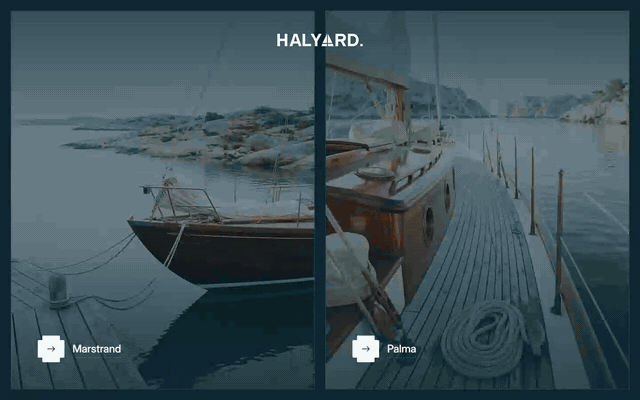

# Halyard

Situs untuk **Halyard**, rumah perawatan, charter, dan restorasi yacht kayu klasik dengan dua pelabuhan: Marstrand (Swedia) dan Palma (Mallorca). Pengunjungnya ada dua: pemilik yacht yang ingin kapalnya dirawat, disewakan, atau direstorasi, dan tamu yang ingin menyewa yacht per hari, minggu, atau musim. Copy situs berbahasa Inggris.

Ini rebuild orisinal yang terinspirasi tata letak dan perilaku sebuah situs referensi. Konsep, brand, teks, palet, logo, gambar, dan kode ditulis atau dibuat baru.

## Halaman

| File | Isi |
| --- | --- |
| `index.html` | Home: gerbang dua pelabuhan, hero, pengantar, tiga layanan, bagian tamu, about |
| `about.html` | Cerita, angka kunci, nilai, tim |
| `season-care.html` | Layanan perawatan tahunan, contoh yacht *Isolde*, perbandingan |
| `charter-management.html` | Layanan pengelolaan charter, contoh yacht *Svala*, marquee armada dan mitra |
| `refit.html` | Restorasi: dua slider before/after, empat kartu keahlian bertumpuk |
| `season-charter.html` | Daftar yacht sewa 1–6 bulan dengan filter dan kalender |
| `book-a-sail.html` | Daftar yacht sewa harian/mingguan |
| `palma.html` | Landing page pelabuhan Palma |
| `the-agency.html` | Profil kantor Palma |
| `our-model.html` | Model kerja dan form estimasi |
| `contact.html` | Form kontak |
| `legal.html`, `privacy.html` | Informasi legal dan privasi |
| `404.html` | Halaman tidak ditemukan |

## Fitur dan interaksi

- **Gerbang pembuka** di home: logo naik per huruf, dua panel membuka, foto berputar saat hover. Klik Marstrand membuka home, klik Palma membuka `palma.html`. Gerbang dilewati saat berpindah dari halaman lain di situs.
- **Reveal hero** dengan clip-path, judul per kata, dan transisi fade antar halaman.
- **Smooth scroll** roda mouse, parallax, section bertumpuk yang miring dan memudar, kartu bertumpuk yang terbang, angka yang menyala di tengah layar.
- **Menu samping** dengan gambar per tautan. Di mobile menjadi menu penuh. Tombol Escape menutupnya.
- **Header** berganti warna sesuai section di bawahnya.
- **Balok dek 3D** (WebGL, shader sendiri) yang mengikuti kursor.
- **Galeri otomatis** dengan thumbnail bertimer, slider testimoni (tombol dan drag), before/after (drag atau panah keyboard).
- **Filter yacht** yang benar-benar menyaring: tanggal, durasi, pelabuhan, jumlah tamu, plus state loading dan "tidak ada hasil".
- **Form** dengan validasi, state gagal dan berhasil. `contact.html?yacht=Svala` mengisi pesan otomatis; `our-model.html#palma` atau `#marstrand` memilih pelabuhan.
- Responsif (dicek di 1440 dan 390 px) dan menghormati `prefers-reduced-motion`. Tidak ada sound.

## Teknologi

HTML, CSS, dan JavaScript native. Tanpa framework, build step, atau CDN; font disimpan lokal.

- Judul: **Newsreader** (pengganti serif berlisensi di referensi, disetel dengan `size-adjust`)
- Teks: **Inter**
- Label: **Share Tech Mono**

## Menjalankan

Buka `index.html` langsung di browser. Tidak perlu server.

## Struktur

```
.
├── index.html, about.html, … (14 halaman)
├── css/style.css        semua gaya; token warna di :root
├── js/main.js           semua perilaku
├── js/yachts.js         data armada untuk dua halaman daftar
├── assets/
│   ├── favicon.svg
│   ├── fonts/           5 file woff2
│   └── img/             55 foto JPG
├── docs/preview/        homepage.gif, hero.png
└── README.md
```

## Mengedit

Edit langsung file yang dibuka browser; tidak ada generator.

- **Teks**: di masing-masing file `.html`. Header, menu, dan footer berulang di tiap halaman, jadi ubah di semuanya (halaman Palma memakai versi menu sendiri: `palma.html`, `the-agency.html`, `our-model.html`).
- **Warna**: variabel `--ink`, `--mist`, `--tide`, `--sail`, `--buoy` di awal `css/style.css`. Beberapa gradasi memakai nilai `rgba(13,42,51,…)` (ink) dan `rgba(212,223,222,0)` (mist).
- **Yacht**: `js/yachts.js` (`type` `week` atau `season`, `season` = bulan awal dan akhir, `months` = durasi maksimum).
- **Gambar**: timpa file dengan nama yang sama di `assets/img/`.
- **Logo**: SVG inline di header, gerbang, dan footer, plus `assets/favicon.svg`. Glyph pada balok 3D ada di fungsi `glyph` dalam `js/main.js`.
- **Pengiriman form**: ganti handler `.js-form` di `js/main.js` dengan layanan pilihan Anda.

## Placeholder yang perlu diganti

- Brand, logo, dan tagline
- Email `crew@halyard.example` dan telepon `+4600000000` (tombol "Call us")
- Alamat Norra Kajen 14, Marstrand dan Moll Vell 3, Palma
- Nama mitra dan rumah charter, testimoni, semua angka, nama yacht (semuanya fiktif)
- Tautan media sosial (`#`)
- Isi `legal.html` dan `privacy.html` ("to be completed")

## Kredit aset

- Foto: gambar AI (Nano Banana lewat Google Flow). Orang, kapal, dan tempat di dalamnya fiktif.
- Font: Newsreader, Inter, Share Tech Mono dari Google Fonts (SIL Open Font License).
- Ikon, logo, dan shader: dibuat untuk proyek ini.

## Keterbatasan

- Font judul dan label adalah pengganti terdekat, jadi bentuk huruf dan sebagian pemenggalan baris berbeda dari referensi.
- Balok 3D adalah shader buatan sendiri, bukan model 3D referensi.
- Pengalih bahasa diganti pengalih pelabuhan (MAR / PMI); situs hanya satu bahasa.
- Transisi antar halaman memuat file baru, jadi header ikut dimuat ulang.
- Daftar yacht memakai data lokal, tanpa API pemesanan. Form tidak mengirim data.
- Foto "after" mengikuti komposisi "before", dengan sedikit detail yang berubah.
